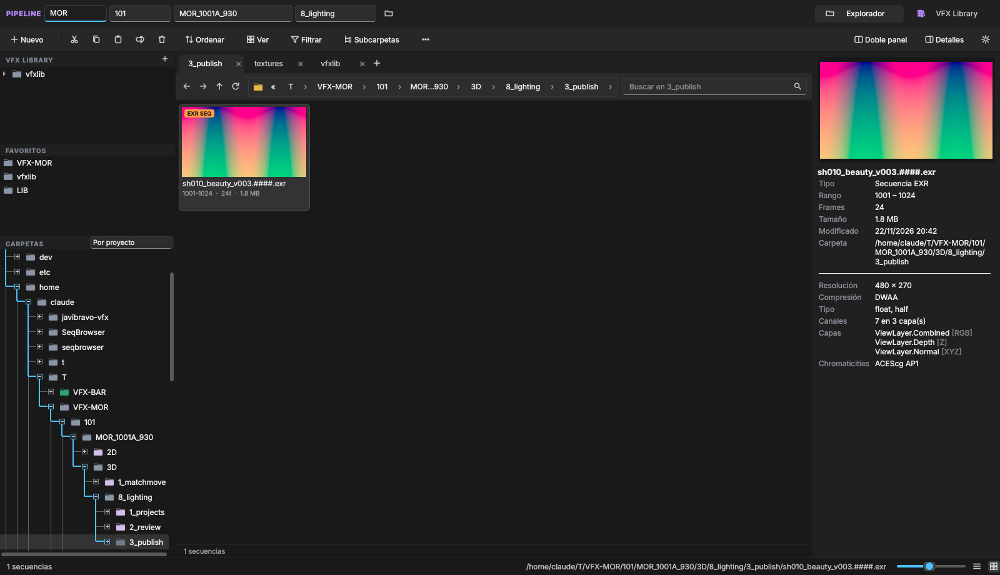
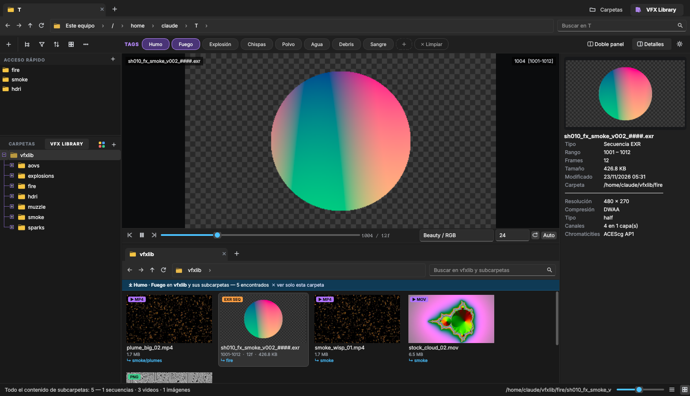

# VFX Explorer

    [](https://github.com/javibravo-vfx/VFX-Explorer/actions/workflows/build.yml)

A **lightweight, portable** file explorer built for VFX, with a clean Windows 11 look and fast, keyboard-friendly folder handling: EXR sequences as a single item, EXR / HDR / TX / video thumbnails, tabs, dual pane, a **VFX Library with a viewer/player**, automatic per-project folder colors and quick pipeline navigation (project › sequence › shot › dept › task).





## Download

Get `VFXExplorer-win64.zip` from **[Releases](https://github.com/javibravo-vfx/VFX-Explorer/releases)**, unzip it anywhere (another drive, the NAS, a USB stick) and run `VFXExplorer.exe`. Nothing to install.

**ffmpeg is included** (LGPL build in `bin\`), so video thumbnails, info and playback work out of the box. PDF previews use pdfium (pypdfium2).

## Features

| | |
|---|---|
| **Windows 11 style** | Explorer-like tabs (fixed width, icon, bold active tab; they only shrink when they don't fit) and a full-width address bar with ← → ↑ ⟳ and «Search…». The **File Explorer / VFX Library** switch sits right of the tabs. In dual pane each pane has its own header on top, aligned with it. Below: **⊕ New**, **Sort**, **View**, Filter, Subfolders and ⋯, then the **pipeline** (or the quick tags in the VFX Library), Dual pane, Details and ⚙. Cut / Copy / Paste / Rename / Delete live in the right-click menu and the usual shortcuts. Dark theme and dark title bar |
| **This PC** | Like Windows 11: local drives and network locations with label, letter (and server for network drives), usage bar (red when almost full) and free space. New tabs open in This PC |
| **Left pane** | **Quick access** on top, one per world. The File Explorer one shows Desktop, Downloads, Pictures and Videos, a divider, and your pinned folders (with a pin). Drag a folder onto it to pin it (from the tree or the center pane); drag inside to reorder. Below, two tabs: **FILE EXPLORER** (This PC and the tree) and **VFX LIBRARY** (the library tree, with ＋ to add folders). Switching tab only shows the other tree: the center changes when you click a folder, so you can open the File Explorer tree and drop a library element there. The 👁 toggles show hidden items; hide Quick access items and drives with right-click › Hide. Next to the tabs: the **automatic colors** button |
| **Folder tree** | › / ⌄ chevrons and **Tree Path Tracing**: a single thin line marks the path from the root to the current folder (solid or dotted lines with ⊞/⊟ boxes are optional). Dropping files on a tree folder copies or moves them there (it expands if you hover). Settings in ⚙ › Colors |
| **VFX Library** | Its own mode (Ctrl+Shift+L), with its tabs in the center between the viewer and the elements, that only browses **inside the library folders**. Its own tree and its own Quick access. Viewer on top and elements in a grid below: move with the arrow keys and each one plays by itself, looped. Plays EXR/JPG/PNG/DPX sequences, MOV/MP4 videos (with ffmpeg) and images / HDRIs. In multi-layer EXRs a selector switches **AOV / channel** (beauty, alpha, depth, normals…); data layers are shown without color conversion and normalized. Space: play/pause · `,` `.`: frame by frame. Drag an element onto a File Explorer tab to copy or move it there |
| **Quick tags** | In the VFX Library, where the pipeline goes: pills like **Smoke, Fire, Explosion, Sparks, Dust, Water…** that show every element of the branch whose name, folder or tag matches (`Fire: fire, flame, fuego`). Several on = any of them. ＋ adds one, right-click edits, reorders or removes |
| **Per-folder view** | Details view by default (This PC: tiles, Pictures: large icons). Every folder remembers its view, icon size, sort, grouping and the Details pane. View › «Apply this view to all folders» makes it the default |
| **Color filters** | Toolbar button that paints file names by pattern (`*.exe = red` by default; text and background colors, `dir:` for folders), set in ⚙ › Colors |
| **Text & PDF preview** | .ini, .txt, .json, .nk, .py… are shown in the whole Details pane, read-only and selectable; PDFs show their pages (and get a thumbnail in the grid) |
| **Original icons** | Programs and documents show their own icon (exe, zip, pdf, office…), images/video/audio keep their thumbnails; can be turned off in ⚙ › General |
| **WinRAR** | If it's installed, the right-click menu can extract archives (here, to a folder, files…) and add files to .rar / .zip |
| **Row numbers** | Details view numbers its rows (View › Row numbers) |
| **Context menus** | Right-click the background for View, Sort by, Group by, Paste, New, Pin, Properties… Right-click the Details column headers to choose columns, «Size column to fit» and «Size all columns to fit» |
| **Thumbnail scrub** | Hover a sequence or video in the grid to scrub through its frames (with the frame number) |
| **Grid** | Names centered and wrapped on up to two lines, like Windows (long names keep their end: extension, `####`) |
| **Grouping** | Sort › Group by: **date modified** (Today, Yesterday, Last week… like Windows 11), type or folder. With **Subfolders** it groups by folder automatically,: the whole branch on one screen, by subfolder |
| **Subfolders** | A switch at the bottom of the center pane (Ctrl+B): **off · 1 level · the whole branch**. No text: shows every file of the folder and its subfolders; with text it searches them. A blue bar tells you you're seeing subfolders and each item shows its subfolder (↳ renders) |
| **Automatic colors** | **By project** (each pipeline project gets a color, lighter on sequences and shots), **By name** (rules like `3D = blue`, `comp = orange`, editable in ⚙ › Colors) or both. Manual color always wins |
| **Sequences** | `plate.1001.exr … plate.1100.exr` → one `plate.####.exr` item with range, frames, total size and **missing frames** in red. Versions (`_v001`) are not mistaken for frames |
| **Thumbnails** | EXR (multi-layer, tiled with mips, ACEScg / ACES2065-1 → sRGB, chromaticities detection), HDR, 16 and 32-bit TIFF, TX, DPX, PSD, TGA, JPG/PNG with alpha over a checkerboard, MOV/MP4/MXF via ffmpeg. Disk cache |
| **Model and folder previews** | `.max`, `.fbx`, `.abc`, `.usd`, `.blend`… use the JPG/PNG with the same name (`rock.max` → `rock.jpg`, `rock_thumb.png`, or inside `thumbs/` or `previews/`). Folders use their `thumbnail.jpg`, `preview.png`, `cover.jpg` or the image named like the folder |
| **Tabs** | Ctrl+T, Ctrl+W, middle click on a folder opens it in a new tab, drag to reorder, remembered on close |
| **Dual pane** | Side by side (F9) or one above the other (F10); F6 switches pane (or click its tabs). One search box and one ← → ↑ ⟳ for both: they work on the active pane. Closing the only tab of a pane closes that pane. Copy or move to the other pane from the menu or by dragging |
| **Breadcrumb** | Every segment is clickable and `›` lists its subfolders. Click the empty space (or Ctrl+L) to type a path |
| **File operations** | Copy / cut / paste (Ctrl+C/X/V, compatible with Windows Explorer), drag in grid or list (onto a folder, the other pane, a tree, a tab, or to/from Windows Explorer), copy and move with progress and cancel, Del sends to the Recycle Bin, Ctrl+Shift+N creates a folder. Sequences are always one item |
| **Rename sequences** | **F2** edits the name in place, like a file: `plate_v001.####.exr` → `sh010_plate_v002.####.exr` renames every frame. Changing the number of `#` changes the padding. «Renumber sequence…» (right-click) changes the first frame (e.g. 1 → 1001) |
| **Folder sizes** | Optional (⚙ › General): computed in the background, shown in grid and list |
| **Tags / rating / collections** | Off by default; enable them in ⚙ › General. Rating ★1–5 (Ctrl+0…5), tags (Ctrl+E) and collections that group assets from different folders without moving them |
| **Search** | Name or part, `*wildcards*`, type filter (including EXR and camera RAW / DNG) and **Subfolders** to search the whole branch (with tags on: `#tag`, `★3`) |
| **Pipeline** | Project → Sequence → Shot → **Dept** → Task, for a structure like `T:\VFX-{PROJ}\{SEQ}\{SHOT}\{DEPT}\{TASK}\{STAGE}\`. Departments can have tasks (`3D\1_matchmove\1_projects`), go straight to the stages (`Comp\2_review`: the last dropdown becomes «Stage») or just hold folders (`_input\plates`: it becomes «Folder»); set which departments have tasks and the stage names in ⚙ › Pipeline. **Switching shot keeps you in the same place** (dept, task, stage, `_input`…) when it exists in the new shot. The dropdowns go above the center pane (default), in the left pane or hidden. The folder button lists every level and its subfolders. The combos follow you as you navigate and clear outside the pipeline |
| **Info** | EXR resolution, data window, compression, channels/AOVs, parts, mipmaps and chromaticities; video codec, fps, duration, timecode and pixel format |
| **Copy path** | `plate.####.exr`, Nuke format `plate.%04d.exr 1001-1100`, Windows path, first frame or folder |

## Shortcuts

| Key | Action |
|---|---|
| Enter / double click | Open (sequences and videos in the configured player) |
| Backspace · Alt+↑ | Up |
| Alt+← / Alt+→ · mouse buttons | Back / Forward |
| Ctrl+T / Ctrl+W / Ctrl+Tab | New tab / close / next |
| F9 / F6 | Dual pane / switch pane |
| Ctrl+C / Ctrl+X / Ctrl+V | Copy / cut / paste files |
| Ctrl+Shift+C · Ctrl+Alt+C | Copy `####` path · Nuke path |
| F2 | Rename in place (sequences too) |
| Ctrl+B | Subfolders: every file of the branch / search the branch |
| Ctrl+Shift+E / Ctrl+Shift+L | File Explorer / VFX Library |
| Space · `,` `.` | (VFX Library) play/pause · previous/next frame |
| Del | Send to the Recycle Bin |
| Ctrl+Shift+N | New folder |
| Ctrl+E · Ctrl+0…5 | Tags · rating (when enabled) |
| Ctrl+L · Ctrl+F | Type a path · search |
| Alt+Shift+P | Details pane |
| Ctrl+1 / Ctrl+2 | Grid / list |
| F5 | Refresh |

## Settings

In ⚙:
- **Player**: mrv2, DJV or OpenRV to open sequences and videos on double click.
- **EXR color space**: ACEScg by default (also used by the viewer).
- **Colors**: folder color (yellow or light blue), automatic mode, name rules and tree lines.
- **VFX Library**: viewer resolution, frame memory (how much of the loop stays cached), autoplay and loop.
- **Pipeline**: root, project prefix, folders that aren't sequences, departments, departments with tasks and stage folders.

Everything (Quick access, tabs, colors, tags, collections, thumbnail cache) is stored in `VFXExplorer_data\` next to the exe. If that folder isn't writable it goes to `%APPDATA%\VFX Explorer`.

> Deleting on a network drive (NAS) is permanent unless the NAS recycle bin is enabled for that shared folder. VFX Explorer warns you first.

## Development

```bat
build.bat              :: creates .venv, installs dependencies and builds dist\VFXExplorer
run.bat                :: runs from source
python tests\test_core.py
```

Every push to `main` builds the exe on GitHub Actions; the zip is kept as a workflow artifact. A `v*` tag creates a Release with the zip:

```bash
git tag v0.54.1 && git push origin v0.54.1
```

Layout: `vfxexplorer/core.py` (sequences, search), `imaging.py` (OpenImageIO / Qt / ffmpeg), `viewer.py` (frame player), `library_ui.py` (VFX Library), `colors.py` (automatic colors), `tree.py` (lined tree), `quicklist.py` (Quick access), `tagbar.py` (quick tags), `dirsize.py`, `library.py` (tags, rating, collections), `pipeline.py` (pipeline structure), `fileops.py`, `models.py`, `pane.py`, `widgets.py`, `mainwindow.py`.
